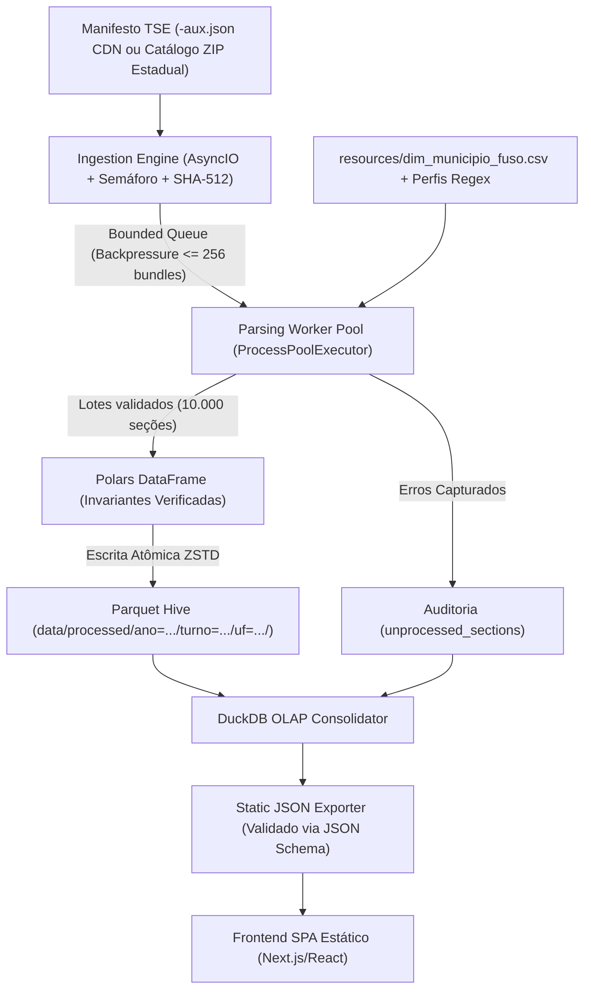

# SPECS.MD: Especificação Técnica Mestra e Arquitetura do Sistema

## 1. Escopo, Objetivos e Matriz de Requisitos
Construir uma infraestrutura determinística, auditável, multiplataforma (Windows/Linux/macOS) e de alto desempenho para auditar os logs públicos de urnas eletrônicas e Boletins de Urna do TSE em escala nacional (~470.000 a 500.000+ seções por turno).

### 1.1. Matriz de Requisitos de Alto Nível

| ID | Domínio | Requisito Resumido | Especificação Detalhada |
| :--- | :--- | :--- | :--- |
| `REQ-ING-01` | Ingestão | Suporte dual às fontes oficiais do TSE: CDN de Resultados (`resultados.tse.jus.br`) e Pacotes ZIP Estaduais (`dadosabertos.tse.jus.br`). | [`specs/01-ingestion-and-sources.md`](./specs/01-ingestion-and-sources.md) |
| `REQ-ING-02` | Ingestão | Validação criptográfica `SHA-512` (quando disponível no manifesto `-aux.json`), rate-limiting, retry exponencial com jitter e checkpoints de retomada. | [`specs/01-ingestion-and-sources.md`](./specs/01-ingestion-and-sources.md) |
| `REQ-ING-03` | Fuso Horário | Dicionário completo de fusos horários por código de município TSE/IBGE (`UTC-2`, `UTC-3`, `UTC-4`, `UTC-5`, incluindo os 13 municípios `UTC-5` do AM e Fernando de Noronha). | [`specs/01-ingestion-and-sources.md`](./specs/01-ingestion-and-sources.md) |
| `REQ-PAR-01` | Parsing | Extração in-memory de arquivos `.logjez` suportando contêineres `7z` (LZMA) e `ZIP` via detecção automática por *magic bytes*, incluindo múltiplos logs por seção (urnas de contingência). | [`specs/02-log-parser-and-fsm.md`](./specs/02-log-parser-and-fsm.md) |
| `REQ-PAR-02` | Parsing / FSM | Máquina de Estados Finita (FSM) determinística sobre `logd.dat` (`ISO-8859-1`, TSV de 6 colunas) com perfis versionados de regex por ciclo eleitoral e proteção contra vazamento de estado. | [`specs/02-log-parser-and-fsm.md`](./specs/02-log-parser-and-fsm.md) |
| `REQ-PAR-03` | Reconciliação | Reconciliação opcional e auditável com o Boletim de Urna (`.bu` ASN.1) para extrair `total_aptos`, `comparecimento_bu` e aferir `divergencia_bu_log`, além de detectar anomalias de relógio (RTC). | [`specs/02-log-parser-and-fsm.md`](./specs/02-log-parser-and-fsm.md) |
| `REQ-ANA-01` | Armazenamento | Persistência colunar em Parquet particionado (`ZSTD`) com escrita atômica e consolidação idempotente em banco analítico DuckDB (`<= 200 MB`). | [`specs/03-data-schemas-and-analytics.md`](./specs/03-data-schemas-and-analytics.md) |
| `REQ-ANA-02` | Analytics | Visões agregadas nacional, estadual (UF), municipal e classificação multinível de seções sinalizadas (*outliers* estatísticos vs. corte literal `sem_bio_apos_17h >= 1`). | [`specs/03-data-schemas-and-analytics.md`](./specs/03-data-schemas-and-analytics.md) |
| `REQ-EXP-01` | Contratos JSON | Exportação determinística de artefatos JSON estáticos validados por JSON Schema estrito, com paginação/limite para proteção de payload web. | [`specs/04-static-api-and-frontend.md`](./specs/04-static-api-and-frontend.md) |
| `REQ-WEB-01` | Frontend SPA | Painel estático Next.js/React com visão nacional, estadual, municipal, explorador de seções sinalizadas e notas metodológicas de transparência eleitoral. | [`specs/04-static-api-and-frontend.md`](./specs/04-static-api-and-frontend.md) |
| `REQ-QA-01` | Qualidade / SDD | Suíte `pytest` funcional com fixtures áureas (`FX-01`..`FX-10`), testes de propriedades/invariantes e CLI unificada (`pulso`). | [`specs/05-testing-evals-and-roadmap.md`](./specs/05-testing-evals-and-roadmap.md) |

---

## 2. Semântica Temporal e Regras de Negócio Fundamentais

### 2.1. Normalização de Fuso Horário e Modo de Pleito
1. O relógio interno da urna eletrônica grava os timestamps no `logd.dat` sempre no **horário local da jurisdição da seção eleitoral**.
2. Define-se `fuso_horario_offset_brt` (`INT`) como a diferença em horas entre o fuso local do município e o Horário Oficial de Brasília (`UTC-3`):
   - Fernando de Noronha (`PE`, `America/Noronha`, `UTC-2`): `fuso_horario_offset_brt = +1`
   - Distrito Federal, Sul, Sudeste, Nordeste continental, GO, TO, PA, AP (`UTC-3`): `fuso_horario_offset_brt = 0`
   - MT, MS, RO, RR e Amazonas Oriental/Central (`UTC-4`): `fuso_horario_offset_brt = -1`
   - Acre (`AC`) e os 13 municípios do Sudoeste do Amazonas (`UTC-5`): `fuso_horario_offset_brt = -2`
3. **Fórmula Canônica de Conversão para Brasília (BRT):**
   $$\text{timestamp\_brt} = \text{timestamp\_local} - \Delta t(\text{horas} = \text{fuso\_horario\_offset\_brt})$$
   *Exemplo de verificação:* No Acre (`offset = -2`), um voto registrado às `15:00:00` locais corresponde a `15:00:00 - (-2h) = 17:00:00 BRT`.
4. **Modo de Encerramento por Ciclo Eleitoral (`cutoff_mode`):**
   - `UNIFIED_BRT` (padrão para eleições `>= 2022`, conforme unificação nacional do TSE): a condição de corte é avaliada sobre `timestamp_brt`.
   - `LOCAL_TIME` (para auditoria retroativa de eleições `<= 2020`, quando o encerramento ocorria às 17h locais): a condição de corte é avaliada sobre `timestamp_local`, mantendo `timestamp_brt` gravado para comparabilidade nacional.

### 2.2. Definição Exata da Fronteira das 17:00:00
Dado o timestamp de referência `ts_ref` (com resolução de 1 segundo no `logd.dat`) de um voto confirmado no dia oficial do turno:
- **Janela Regular (`ate_17h`):** `ts_ref < 17:00:00` (isto é, até `16:59:59` inclusive). Votos eventualmente computados antes das `08:00:00` entram em `votos_ate_17h`, mas incrementam `votos_antes_08h` e acionam `relogio_suspeito = TRUE`.
- **Janela Pós-Encerramento (`apos_17h`):** `ts_ref >= 17:00:00` (a partir de `17:00:00` inclusive).

> **Nota Metodológica de Domínio:** Pela legislação eleitoral brasileira, eleitores presentes na fila da seção até as `17:00:00` recebem senhas e exercem legitimamente o voto após esse horário. Portanto, `votos_apos_17h > 0` não configura irregularidade por si só; o sistema audita a consistência temporal, a taxa relativa de habilitação sem biometria antes vs. depois das 17h e a reconciliação matemática com o Boletim de Urna.

---

## 3. Resumo do Dicionário de Eventos do `logd.dat`

Cada registro do `logd.dat` possui 6 colunas separadas por tabulação (`\t`) em codificação `ISO-8859-1`:
`{DD/MM/AAAA HH:MM:SS}\t{NIVEL}\t{ID_UE}\t{APLICATIVO}\t{MENSAGEM}\t{MAC_HEX}`

O subsistema de votação (`APLICATIVO == "VOTA"` ou eventos correlatos de abertura/encerramento) é processado pela Máquina de Estados Finita detalhada em [`specs/02-log-parser-and-fsm.md`](./specs/02-log-parser-and-fsm.md):

| Evento Canônico | Padrões Representativos no `logd.dat` (Perfil `v2022_2026`) | Efeito na Máquina de Estados |
| :--- | :--- | :--- |
| `VOTING_OPENED` | `Urna pronta para receber votos` | Habilita contabilização de votos da seção no dia oficial do pleito (ignora eventos de carga/teste anteriores). |
| `VOTER_SESSION_START` | `Aguardando digitação do título` / `Identificador do eleitor digitado pelo mesário` | Inicia/reinicia buffer transitório do eleitor atual (`bio_status = UNKNOWN`). |
| `BIO_SUCCESS` | `Tipo de habilitação do eleitor [biométrica]` / `Habilitação do eleitor por biometria` | Define `bio_status = BIOMETRIC` para o eleitor em atendimento. |
| `BIO_FAIL` | `Tentativa de identificação biométrica falhou` / `Digital não reconhecida` | Incrementa `tentativas_bio_falhas` sem definir liberação final. |
| `BIO_BYPASS` | `Tipo de habilitação do eleitor [manual]` / `[biográfica]` / `Habilitação manual sem biometria` / `Solicitação de dado pessoal do eleitor para habilitação` | Define `bio_status = MANUAL_BYPASS` para o eleitor em atendimento. |
| `VOTE_CONFIRMED` | `O voto do eleitor foi computado` | Incrementa `total_votos` (+1), classifica faixa horária (`< 17:00:00` vs `>= 17:00:00`), vincula `bio_status` e **reseta** o buffer do eleitor. |
| `VOTER_ABORTED` | `Votação cancelada pelo mesário` / `Suspensão de voto` / `Eleitor suspenso` | Incrementa `votos_cancelados_suspensos` e **reseta** imediatamente o buffer do eleitor (impede contaminação do próximo votante). |
| `SECTION_CLOSED` | `Encerramento da seção eleitoral` / `Votação encerrada` | Registra encerramento formal; qualquer `VOTE_CONFIRMED` subsequente marca anomalia crítica. |

---

## 4. Arquitetura de Dados e Esquema de Armazenamento

### 4.1. Tabela Granular de Seção (`raw_section_metrics`)
Persistida em Parquet particionado (`data/processed/ano={ANO}/turno={T}/uf={UF}/part-*.parquet`, compressão `ZSTD`) e consolidada no DuckDB com chave primária composta `(ano_eleicao, turno, pleito_id, uf, municipio_cod, zona, secao)`:

```sql
CREATE TABLE raw_section_metrics (
    ano_eleicao SMALLINT NOT NULL,
    turno TINYINT NOT NULL,                       -- 1 ou 2
    pleito_id INTEGER NOT NULL,                   -- Ex.: 406 (1º turno 2022), 407 (2º turno 2022)
    uf VARCHAR(2) NOT NULL,
    municipio_cod INTEGER NOT NULL,               -- Código TSE de 5 dígitos (ex.: 71072 para São Paulo)
    municipio_ibge INTEGER,                       -- Código IBGE de 7 dígitos para geoprocessamento
    municipio_nome VARCHAR(120) NOT NULL,
    zona SMALLINT NOT NULL,
    secao SMALLINT NOT NULL,
    fuso_horario_offset_brt TINYINT NOT NULL,     -- Offset em horas vs BRT (-2, -1, 0, +1)
    cutoff_mode VARCHAR(16) NOT NULL,             -- 'UNIFIED_BRT' ou 'LOCAL_TIME'
    qtd_arquivos_log TINYINT NOT NULL DEFAULT 1,  -- >1 indica substituição de urna/contingência
    total_aptos INTEGER,                          -- Extraído do BU / manifesto de eleitorado
    comparecimento_bu INTEGER,                    -- Extraído do BU quando disponível
    total_votos INTEGER NOT NULL,                 -- Votos computados no logd.dat
    divergencia_bu_log INTEGER,                   -- (comparecimento_bu - total_votos); NULL se sem BU
    votos_antes_08h INTEGER NOT NULL DEFAULT 0,
    votos_ate_17h INTEGER NOT NULL,
    votos_apos_17h INTEGER NOT NULL,
    sem_bio_ate_17h INTEGER NOT NULL,
    sem_bio_apos_17h INTEGER NOT NULL,
    bio_status_indefinido INTEGER NOT NULL DEFAULT 0,
    tentativas_bio_falhas INTEGER NOT NULL DEFAULT 0,
    votos_cancelados_suspensos INTEGER NOT NULL DEFAULT 0,
    qtd_reinicializacoes SMALLINT NOT NULL DEFAULT 0,
    horario_abertura_brt TIMESTAMP,
    horario_primeiro_voto_brt TIMESTAMP,
    horario_ultimo_voto_brt TIMESTAMP,
    horario_encerramento_brt TIMESTAMP,
    relogio_suspeito BOOLEAN NOT NULL DEFAULT FALSE,
    voto_apos_encerramento BOOLEAN NOT NULL DEFAULT FALSE,
    status_processamento VARCHAR(24) NOT NULL,    -- 'SUCCESS', 'MISSING_LOG', 'CORRUPT_ARCHIVE', 'HASH_MISMATCH', 'PARSE_ERROR'
    PRIMARY KEY (ano_eleicao, turno, pleito_id, uf, municipio_cod, zona, secao)
);
```

### 4.2. Tabela de Auditoria de Falhas (`unprocessed_sections`)
Cumpre a exigência de rastreabilidade integral sem interrupção de lote:

```sql
CREATE TABLE unprocessed_sections (
    ano_eleicao SMALLINT NOT NULL,
    turno TINYINT NOT NULL,
    pleito_id INTEGER NOT NULL,
    uf VARCHAR(2) NOT NULL,
    municipio_cod INTEGER NOT NULL,
    zona SMALLINT NOT NULL,
    secao SMALLINT NOT NULL,
    error_code VARCHAR(32) NOT NULL,              -- 'MISSING_LOG', 'CORRUPT_ARCHIVE', 'HASH_MISMATCH', 'PARSE_ERROR', 'HTTP_EXHAUSTED'
    error_message VARCHAR(500) NOT NULL,
    source_uri VARCHAR(500),
    sha512_expected VARCHAR(128),
    sha512_actual VARCHAR(128),
    attempt_count TINYINT NOT NULL DEFAULT 1,
    recorded_at TIMESTAMP NOT NULL,
    PRIMARY KEY (ano_eleicao, turno, pleito_id, uf, municipio_cod, zona, secao)
);
```

### 4.3. Visões de Agregação Analítica (DuckDB)
Todas as agregações estatísticas de votação filtram `WHERE status_processamento = 'SUCCESS'` e utilizam `COALESCE(..., 0.0)` com `NULLIF(..., 0)` para evitar divisões por zero (detalhes SQL completos em [`specs/03-data-schemas-and-analytics.md`](./specs/03-data-schemas-and-analytics.md)):

1. **`summary_national`:** Totalizador nacional por `(ano_eleicao, turno)` contendo totais de seções auditadas/não processadas, `total_votos_brasil`, `votos_apos_17h_brasil`, `pct_apos_17h`, `pct_sem_bio_ate_17h`, `pct_sem_bio_apos_17h` e contagem de seções por nível de alerta.
2. **`summary_by_uf`:** Totalizador estadual agrupado por `(ano_eleicao, turno, uf)` com métricas homólogas, médias, medianas e desvios-padrão estaduais usados como linha de base para cálculo de *outliers*.
3. **`summary_by_municipio`:** Totalizador municipal agrupado por `(ano_eleicao, turno, uf, municipio_cod, municipio_nome)` para suportar drill-down geográfico completo no painel SPA.
4. **`flagged_sections`:** Visão enriquecida de seções sinalizadas com classificação em três níveis objetivos:
   - `TIER_1_POST_17H_NO_BIO`: Critério literal base (`sem_bio_apos_17h >= 1`).
   - `TIER_2_STATISTICAL_OUTLIER`: Critério de limite de controle estatístico (`votos_apos_17h >= 10` E (`delta_sem_bio_pp >= 15.0` OU `z_score_uf >= 3.0`)).
   - `TIER_3_CRITICAL_ANOMALY`: Anomalia estrutural (`divergencia_bu_log != 0`, `voto_apos_encerramento = TRUE` ou `relogio_suspeito = TRUE`).

---

## 5. Pipeline de Execução e Controle de Backpressure



---

## 6. Invariantes Matemáticas Obrigatórias
Qualquer lote rejeitado pelas invariantes abaixo deve falhar nos testes automatizados e acionar erro explícito de integridade:
1. `total_votos == votos_ate_17h + votos_apos_17h`
2. `0 <= sem_bio_ate_17h <= votos_ate_17h`
3. `0 <= sem_bio_apos_17h <= votos_apos_17h`
4. `total_votos == 0` implica obrigatoriamente `horario_primeiro_voto_brt IS NULL` e `horario_ultimo_voto_brt IS NULL`.
5. `total_votos > 0` implica obrigatoriamente `horario_primeiro_voto_brt <= horario_ultimo_voto_brt`.
6. Para toda seção presente no manifesto de entrada, existe exatamente 1 registro correspondente em `raw_section_metrics` (e, quando `status_processamento != 'SUCCESS'`, exatamente 1 registro diagnóstico em `unprocessed_sections`).

---

## 7. Requisitos Não-Funcionais e SLAs Calibrados

1. **Throughput de Parsing e Descompactação:**
   - **Motor de Parsing Puro (sobre `bytes` já extraídos em memória):** `>= 1.500 logs/segundo` em máquina de 8 núcleos modernos (ou `>= 200 MB/s` por núcleo via pré-filtragem em `bytes` antes da decodificação `latin-1`).
   - **Throughput End-to-End Local (incluindo descompactação `7z`/LZMA de `.logjez`):** `>= 300 a 800 seções/segundo` em 8 workers CPU-bound, processando as ~472.000 seções do país em `10 a 26 minutos` a partir de pacotes locais.
2. **Teto Estrito de Memória RAM:**
   - Consumo total residente (processo orquestrador + 8 workers) **não deve ultrapassar 8 GB de RAM**.
   - **Proibição de Alocação Massiva:** Arquivos `.zip` estaduais do portal de Dados Abertos (que podem atingir 10 GB a 45 GB em UFs como SP/MG) jamais devem ser carregados integralmente em `io.BytesIO`; apenas entradas individuais `.logjez`/`.bu` (~50 KB a 300 KB cada) transitam em buffers em memória, controladas por fila limitada (*bounded queue*).
3. **Orçamento de Armazenamento Final:**
   - O arquivo consolidado DuckDB (`pulso_eleitoral.duckdb`) para um turno nacional (~500.000 seções) **não deve exceder 200 MB**.
   - Os payloads JSON estáticos iniciais carregados na abertura da home do painel SPA (`metadata.json` + `national_summary.json` + `states_summary.json`) **não devem exceder 250 KB** somados (sem compressão) para garantir *First Contentful Paint* instantâneo.
4. **Determinismo e Reprodutibilidade:**
   - Ordenação explícita (`ORDER BY`) em todas as exportações JSON e arredondamento padronizado em 4 casas decimais para percentuais (`ROUND(val, 4)`), garantindo *byte-for-byte reproducibility* (exceto campo `generated_at` em `metadata.json`).
