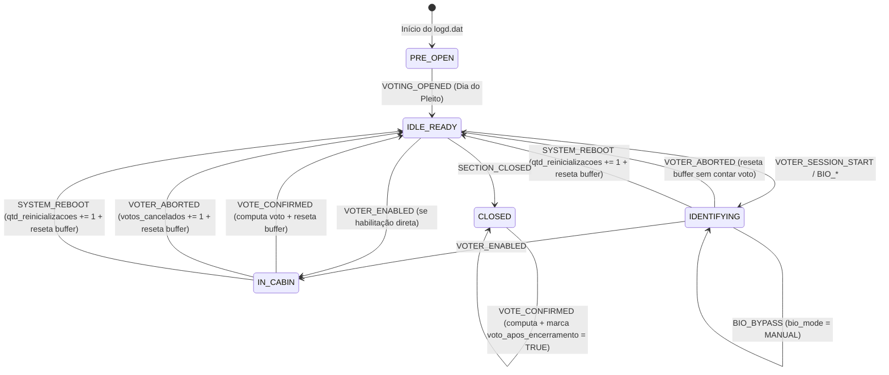

# Especificação 02: Extração Binária, Gramática de Log e Máquina de Estados (FSM)

**Agente Responsável:** `agent-parser` (`src/pulso_eleitoral/parser/`)  
**Requisitos Cobertos:** `REQ-PAR-01`, `REQ-PAR-02`, `REQ-PAR-03`

---

## 1. Extração In-Memory de Arquivos `.logjez` (`REQ-PAR-01`)

Os arquivos `.logjez` (ou `-log.jez`) distribuídos pelo TSE variam de contêiner de compressão conforme a geração do ecossistema de totalização. O extrator **NUNCA** deve confiar na extensão do arquivo, devendo inspecionar os *magic bytes* iniciais do buffer em memória:

| Assinatura Hexadecimal (*Magic Bytes*) | Formato Real | Biblioteca / Estratégia em Memória |
| :--- | :--- | :--- |
| `37 7A BC AF 27 1C` (primeiros 6 bytes) | **7-Zip (`7z` / LZMA / LZMA2)** | `py7zr.SevenZipFile(io.BytesIO(raw_bytes), mode="r")` extraindo entradas `logd*.dat`. |
| `50 4B 03 04` (primeiros 4 bytes) | **ZIP Padrão (`DEFLATE`)** | `zipfile.ZipFile(io.BytesIO(raw_bytes), mode="r")` extraindo entradas `logd*.dat`. |
| Qualquer outro prefixo ou buffer vazio | **Arquivo Inválido/Corrompido** | Levantar `CorruptArchiveError` -> registrado em `unprocessed_sections` com `error_code = 'CORRUPT_ARCHIVE'`. |

### 1.1. Tratamento de Múltiplos Logs e Urnas de Contingência
1. Um pacote `.logjez` (ou um `SectionArtifactBundle` com múltiplos `LogArtifactPayload`) pode conter mais de um arquivo `logd*.dat` quando ocorre substituição de urna durante o expediente.
2. **Descarte de Linhas Duplicadas entre Mídias:** Quando uma mídia de resultado é transferida da urna original para a urna de contingência, o `logd.dat` da contingência pode conter as mesmas linhas iniciais já gravadas na primeira urna.
3. **Algoritmo de Fusão Canônica:**
   - Extrair todas as linhas válidas de todos os `logd*.dat` da seção.
   - Deduplicar linhas idênticas preservando a ordem cronológica estrita `(timestamp_local, sequencia_original)` usando o hash de integridade final da linha (`MAC_HEX` da 6ª coluna) + timestamp + mensagem como chave de idempotência intrasseção.

---

## 2. Anatomia da Linha do `logd.dat` e Fast-Path em Bytes (`REQ-PAR-02`)

### 2.1. Gramática Estrutural TSV
- **Codificação de Caracteres:** `ISO-8859-1` (`latin-1`), com quebras de linha `\r\n` ou `\n`.
- **Colunas (6 campos separados por `\t` — ASCII `0x09`):**
  1. `col[0]` — **Data/Hora Local:** Formato fixo `DD/MM/YYYY HH:MM:SS` (19 bytes ASCII, ex.: `02/10/2022 16:59:58`).
  2. `col[1]` — **Nível de Severidade:** `INFO`, `WARN`, `ERRO`, `alerta`, etc.
  3. `col[2]` — **Identificador do Equipamento / Código:** Inteiro ASCII (ex.: `67305985`).
  4. `col[3]` — **Subsistema / Aplicativo:** Ex.: `VOTA`, `GAP`, `ATUALIZADOR`, `SCUE`, `RED`.
  5. `col[4]` — **Mensagem Descritiva do Evento:** Texto em `ISO-8859-1` (ex.: `Tipo de habilitação do eleitor [biométrica]`).
  6. `col[5]` — **Código de Integridade (MAC):** Hexadecimal de 16 caracteres (ex.: `A1B2C3D4E5F60718`).

### 2.2. Otimização de Performance (Byte-Level Pre-Filtering)
Um arquivo `logd.dat` típico contém de `5.000` a `25.000` linhas, das quais mais de `75%` referem-se a diagnóstico de hardware, carga prévia, verificação de bateria e eventos gráficos irrelevantes para a contagem de votos/biometria. Para cumprir o SLA de throughput (`>= 1.500 logs/s` em 8 cores):
1. Iterar sobre `raw_dat_bytes.splitlines()` diretamente em `bytes` (zero alocação de `str` UTF-8 inicial).
2. Verificar filtro rápido de data oficial do turno (`line[:10] == election_date_ddmmyyyy_bytes`, exceto para capturar metadados de cabeçalho como município/zona/seção/aptos ou votos que cruzem a meia-noite em fila extrema `election_next_day_bytes`).
3. Verificar se a linha pertence ao aplicativo de votação ou controle (`b"\tVOTA\t" in line` ou palavras-chave de boot/encerramento).
4. **Cálculo Aritmético Direto de Horário (Zero `datetime.strptime` no Hot Loop):**
   - Extrair inteiros diretamente por *byte slicing*:
     `hh = (line[11] - 48) * 10 + (line[12] - 48)`
     `mm = (line[14] - 48) * 10 + (line[15] - 48)`
     `ss = (line[17] - 48) * 10 + (line[18] - 48)`
   - Converter para segundos desde `00:00:00` do dia da eleição (`+ 86400` se a data for `D+1`), aplicar `- fuso_horario_offset_brt * 3600` quando `cutoff_mode == "UNIFIED_BRT"`, e comparar diretamente com `61200` (`17 * 3600`).

---

## 3. Perfis Versionados de Padrões (`LogPatternProfile`)

Como mensagens textuais do software da urna podem sofrer ajustes redacionais entre ciclos eleitorais (UE2020, UE2022, UE2024, UE2026), é **proibido** codificar expressões regulares literais espalhadas no motor da FSM. Os padrões são carregados de `resources/log_patterns/{profile}.toml` e pré-compilados uma única vez por worker:

| Evento Canônico | Padrões Suportados (Case-Insensitive / Latin-1) |
| :--- | :--- |
| `VOTING_OPENED` | `Urna pronta para receber votos` \| `Início da votação` |
| `VOTER_SESSION_START` | `Aguardando digitação do (título\|identificador)` \| `(Título\|Identificador do eleitor) digitado pelo mesário` |
| `BIO_SUCCESS` | `Tipo de habilitação do eleitor \[biométrica\]` \| `Habilitação do eleitor por biometria` \| `Biometria do eleitor reconhecida` \| `Eleitor habilitado por biometria` |
| `BIO_FAIL` | `Tentativa de identificação biométrica falhou` \| `Digital não reconhecida` \| `Não foi possível reconhecer a digital` |
| `BIO_BYPASS` | `Tipo de habilitação do eleitor \[(manual\|biográfica\|biografica)\]` \| `Habilitação manual sem biometria` \| `Mesário habilitou o eleitor sem biometria` \| `Solicitação de dado pessoal do eleitor para habilitação` \| `Eleitor sem biometria cadastrada` |
| `VOTER_ENABLED` | `Eleitor foi habilitado` |
| `VOTE_CONFIRMED` | `O voto do eleitor foi computado` \| `Voto do eleitor computado` |
| `VOTER_ABORTED` | `Votação cancelada` \| `Suspensão de voto` \| `Eleitor suspenso pelo mesário` \| `Cancelamento de habilitação` |
| `SYSTEM_REBOOT` | `Inicializando aplicação` \| `Urna ligada` \| `Reinício do sistema` |
| `SECTION_CLOSED` | `Encerramento da seção eleitoral` \| `Votação encerrada` \| `Emissão do boletim de urna` |

---

## 4. Máquina de Estados Finita (FSM) Determinística do Eleitor

### 4.1. Regras Estritas de Transição e Casos de Borda
1. **Proteção Pré-Abertura (`PRE_OPEN`):** Eventos anteriores a `VOTING_OPENED` na data oficial da eleição são ignorados na contagem de votos, impedindo que testes de carga/simulados em cartório contaminem a seção. (Caso um log corrompido/truncado no início já comece no meio do expediente com `VOTER_SESSION_START` na data da eleição sem `VOTING_OPENED`, transiciona para `IDENTIFYING` e marca flag diagnóstica interna).
2. **Precedência Biométrica com Retentativa:** Se o eleitor sofre 1 a 3 eventos `BIO_FAIL` e na 4ª tentativa obtém `BIO_SUCCESS`, `tentativas_bio_falhas` soma as falhas, mas `bio_mode` final é `BIOMETRIC` (pois a digital acabou reconhecida). Se após `BIO_FAIL` ocorrer `BIO_BYPASS`, `bio_mode` final é `MANUAL`.
3. **Ausência Explícita de Tag Biométrica (`bio_mode == UNKNOWN` no momento de `VOTE_CONFIRMED`):**
   - Jamais assumir silenciosamente `BIOMETRIC` ou `MANUAL` sem rastreio: se nenhuma linha `BIO_SUCCESS` nem `BIO_BYPASS` precedeu `VOTE_CONFIRMED` na sessão daquele eleitor, incrementar `bio_status_indefinido += 1` (não incrementando `sem_bio_*` por inferência cega, ou seguindo flag explícita de versão de urna onde toda liberação biométrica emite captura de digital).
4. **Isolamento Total entre Eleitores:** Todo evento `VOTE_CONFIRMED`, `VOTER_ABORTED`, `SYSTEM_REBOOT` ou novo `VOTER_SESSION_START` **limpa obrigatoriamente** `bio_mode = UNKNOWN`.
5. **Detecção de Relógio Descalibrado (`relogio_suspeito`):**
   - Marca-se `relogio_suspeito = TRUE` se qualquer uma das condições ocorrer:
     - `votos_antes_08h > 0` (voto confirmado antes de `08:00:00` no fuso local da seção);
     - `horario_abertura_local < 07:00:00` (abertura fora da janela operacional permitida pelo TSE);
     - Regressão monotônica de relógio superior a `60 segundos` entre duas linhas consecutivas de `VOTA` na mesma urna.

---

## 5. Reconciliação com Boletim de Urna (`.bu`) (`REQ-PAR-03`)

Quando `SectionArtifactBundle.bu_raw_bytes` estiver presente:
1. Decodificar a estrutura `EntidadeBoletimUrna` (ASN.1 BER compilado via `asn1tools` a partir do schema versionado em `resources/asn1/bu_tse.asn1`, com fallback TLV BER resiliente em memória) para extrair os contadores de cabeçalho (`qtdEleitoresAptos`, `qtdComparecimento` máximo entre cargos em disputa na seção).
2. Preencher `total_aptos` (priorizando o valor do `.bu`, com fallback para `total_aptos_manifest` ou linha de abertura do `logd.dat`).
3. Preencher `comparecimento_bu` e calcular `divergencia_bu_log = comparecimento_bu - total_votos`.
4. Qualquer falha isolada no parser do `.bu` não invalida o resultado do `logd.dat` (deixa `comparecimento_bu = None` e registra warning estruturado).

---

## 6. Contrato Python de Saída (`ParsedSectionMetrics` | `UnprocessedSectionError`)

Ambos definidos em `src/pulso_eleitoral/contracts/models.py` como `@dataclass(slots=True, frozen=True)` serializáveis via `pickle` com overhead mínimo entre processos do `ProcessPoolExecutor` e diretamente conversíveis em linhas Arrow/Polars.
